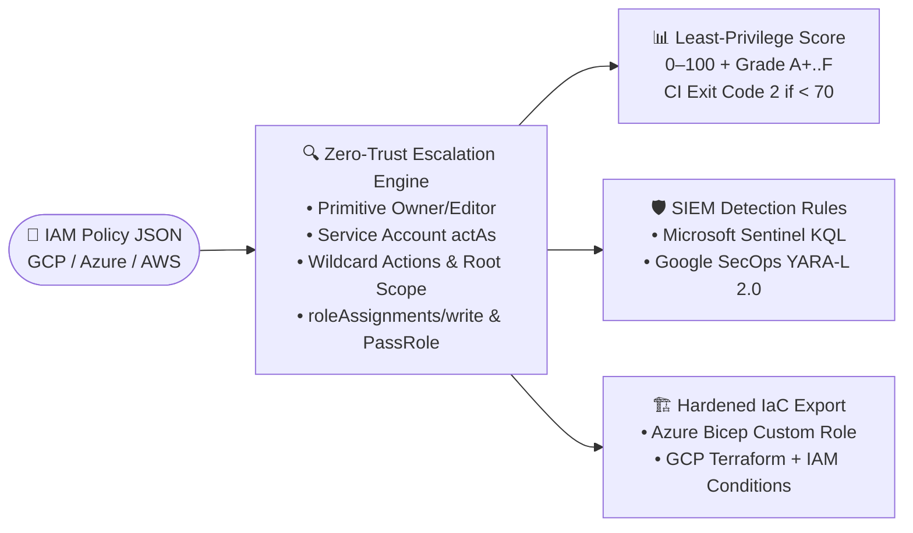

<div align="center">

# ☁️ Cloud IAM Zero-Trust — GCP, Microsoft Azure & AWS Privilege Escalation Auditor

[](https://wallisonws.github.io/cloud-iam-zero-trust/)
[](#)
[](#)
[](LICENSE)

**Zero-dependency Multi-Cloud IAM Zero-Trust Auditor (Python + Native Windows PowerShell + Live Trilingual Web Studio EN/PT-BR/ES) detecting privilege escalation paths in Google Cloud (GCP IAM), Microsoft Azure (RBAC / Entra ID) & AWS IAM — with instant Microsoft Sentinel KQL, Google SecOps YARA-L 2.0, Azure Bicep & GCP Terraform remediation exports.**

</div>

---

## 🧭 Multi-Cloud Zero-Trust Audit Pipeline



---

## ✨ Built for Cloud Security Teams (Google Cloud, Microsoft Azure & AWS)

| Cloud Provider | Detected Escalation & Exposure Patterns | Instant Remediation & Detection Exports |
| :--- | :--- | :--- |
| **Google Cloud (GCP IAM)** | `roles/owner`, `roles/editor`, `iam.serviceAccounts.actAs` / `getAccessToken` impersonation, `allUsers` / `allAuthenticatedUsers` public bindings | **Google SecOps (Chronicle) YARA-L 2.0** detection rule + **Terraform** time-bound IAM Conditions (BeyondCorp) |
| **Microsoft Azure / Entra ID** | Wildcard `"actions": ["*"]`, `Microsoft.Authorization/roleAssignments/write` escalation, tenant root `"assignableScopes": ["/"]` | **Microsoft Sentinel KQL** `AzureActivity` rule + **Azure Bicep** least-privilege custom role |
| **Amazon Web Services (AWS IAM)** | Wildcard `"Action": "*"` / `*:*`, `iam:PassRole`, `CreatePolicyVersion`, `AttachRolePolicy`, `PutUserPolicy` | Least-privilege action enumeration & `iam:PassedToService` boundary guidance |

---

## 🚀 Quick Start (Zero Dependencies)

```bash
# Python CLI (Python 3 stdlib — exits with code 2 if score < 70 for CI/CD gating)
python3 iam_audit.py policy.json
```

```powershell
# Windows PowerShell Native CLI (Azure / Entra ID & Hybrid AD Admins)
.\iam_audit.ps1 -PolicyJson '{"actions":["*","Microsoft.Authorization/roleAssignments/write"],"assignableScopes":["/"]}'

# Or audit from a file
.\iam_audit.ps1 -Path .\azure-role.json
```

---

## 🧩 More Free Open-Source Tools by [@WallisonWS](https://github.com/WallisonWS)

* ⚡ **[headroom-shield](https://github.com/WallisonWS/headroom-shield)** — Zero-dep LLM Context Compressor (60–95% token savings) + OWASP Prompt-Injection Shield + MCP Server.
* 🛡️ **[aegis-llm-guard](https://github.com/WallisonWS/aegis-llm-guard)** — OWASP LLM Top 10 Prompt-Injection Firewall & Reversible LGPD/PII Vault for Gemini / Vertex AI.
* 📈 **[sre-osv-sentinel](https://github.com/WallisonWS/sre-osv-sentinel)** — Google SRE Multi-Burn-Rate SLO Generator (`PromQL`) & live `api.osv.dev` CVE Scanner.
* 🧰 **[devsecops-toolkit](https://github.com/WallisonWS/devsecops-toolkit)** — 18-in-1 Multilingual DevSecOps, Networking & Crypto Workbench (EN / PT-BR / ES).

Created by **[@WallisonWS](https://github.com/WallisonWS)** • MIT License.
